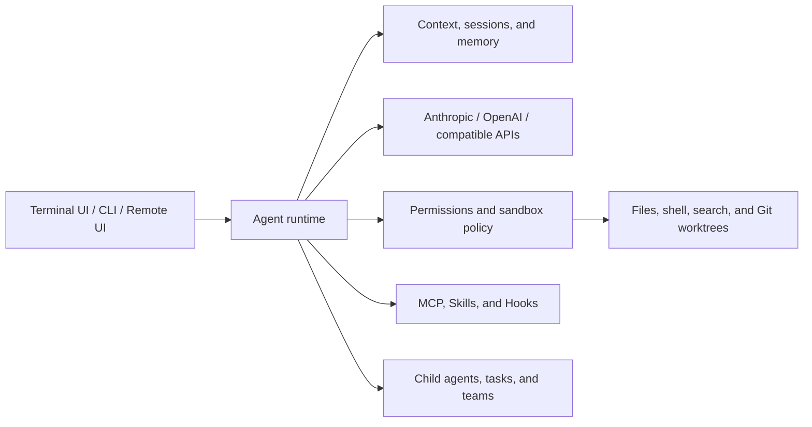

# LuxCode

**A terminal-first AI coding assistant with explicit permissions, durable context, and multi-agent workflows.**

[English](README.md) | [简体中文](README.zh-CN.md)

LuxCode connects large language models to a practical coding runtime. It can inspect and edit files, run commands, search a repository, retain project context, call MCP servers, and coordinate specialized agents—all from an interactive terminal interface.

The project is designed around a simple idea: an AI coding assistant should have useful tools, but every action should still pass through visible and configurable boundaries.

## Highlights

- **Terminal-native workflow** — a streaming Textual UI for conversations, tool calls, status, plans, and background tasks.
- **Multiple model protocols** — works with Anthropic, OpenAI, and OpenAI-compatible endpoints.
- **Agentic tool loop** — built-in file reading, writing, editing, shell execution, globbing, and code search.
- **Permission controls** — choose between confirmation-first, edit-friendly, planning, and unrestricted modes.
- **Context and memory** — session persistence, automatic and manual context compaction, project memory, and file checkpoints.
- **Extensible runtime** — add MCP servers, reusable Skills, lifecycle Hooks, and dynamically discovered tools.
- **Multi-agent execution** — delegate work to child agents, run background tasks, and coordinate agent teams.
- **Git-aware isolation** — create and manage worktrees for parallel changes without mixing working directories.
- **Three ways to run** — interactive TUI, non-interactive CLI/NDJSON, or a browser-based remote interface.

## Architecture



At its core, LuxCode runs an event-driven loop: it builds the current context, streams a model response, validates requested tool calls, executes approved actions, feeds the results back to the model, and continues until the task is complete.

## Requirements

- Python 3.11 or newer
- [uv](https://docs.astral.sh/uv/) for dependency and environment management
- Git for repository and worktree features
- Node.js only when an MCP server is launched through `npx`
- An API key for at least one configured model provider

## Quick start

Clone the repository and install its dependencies:

```bash
git clone https://github.com/diveintonull/luxcode.git
cd luxcode
uv sync
```

Create `.luxcode/config.yaml` in the project directory:

```yaml
providers:
  - name: anthropic
    protocol: anthropic
    base_url: https://api.anthropic.com
    api_key: ""
    model: your-model-name
    thinking: false

permission_mode: default
mcp_servers: []
```

Leave `api_key` empty to read it from the environment:

```bash
export ANTHROPIC_API_KEY="your-api-key"
# or, for OpenAI and OpenAI-compatible providers:
export OPENAI_API_KEY="your-api-key"
```

On PowerShell, use `$env:ANTHROPIC_API_KEY = "your-api-key"` or `$env:OPENAI_API_KEY = "your-api-key"`.

Start the interactive interface:

```bash
uv run luxcode
```

## Configuration

LuxCode loads and merges configuration from these locations, in order:

1. `~/.luxcode/config.yaml`
2. `<project>/.luxcode/config.yaml`
3. `<project>/.luxcode/config.local.yaml`

This makes it possible to keep shared provider defaults in your home directory and override them per project. Local `.luxcode` files are ignored by Git in this repository so API keys are not committed accidentally.

### OpenAI example

```yaml
providers:
  - name: openai
    protocol: openai
    base_url: https://api.openai.com/v1
    api_key: ""
    model: your-model-name
```

For another OpenAI-compatible service, set `protocol: openai-compat` and provide its API base URL.

### MCP example

LuxCode supports local stdio servers as well as Streamable HTTP endpoints:

```yaml
mcp_servers:
  - name: context7
    command: npx
    args: ["-y", "@upstash/context7-mcp"]

  - name: remote-tools
    url: https://example.com/mcp
    headers:
      Authorization: "Bearer ${MY_MCP_TOKEN}"
```

Environment variables written as `${NAME}` are expanded at runtime.

## Usage

### Interactive mode

```bash
uv run luxcode
```

Useful slash commands include:

| Command | Purpose |
| --- | --- |
| `/help` | Show available commands and usage |
| `/plan` | Switch to planning mode |
| `/permission` | Inspect or change permission rules |
| `/sandbox` | Configure OS-level command isolation |
| `/compact` | Compact the active context |
| `/memory` | List, edit, or clear stored memory |
| `/session` | Create, list, resume, or delete sessions |
| `/mcp` | Show MCP server status |
| `/skill` | Inspect and reload Skills |
| `/tasks` | Inspect or cancel background tasks |
| `/trace` | Display the agent parent-child tree |
| `/worktree` | Manage isolated Git worktrees |
| `/rewind` | Return to an earlier file checkpoint |
| `/status` | Show the current runtime status |

### Non-interactive mode

Run a single prompt and print the final response:

```bash
uv run luxcode -p "Explain the architecture of this repository"
```

Emit newline-delimited JSON events for scripts and integrations:

```bash
uv run luxcode -p "Review the current changes" --output-format stream-json
```

### Remote mode

```bash
uv run luxcode --remote
```

Then open `http://localhost:18888`. Remote mode binds to `0.0.0.0:18888`, so use it only on a trusted network or protect the port with an appropriate firewall or proxy.

### Permission modes

Override the configured mode for one run with `--mode`:

```bash
uv run luxcode --mode acceptEdits
```

| Mode | File reads | File writes | Commands |
| --- | --- | --- | --- |
| `default` | Allow | Ask | Ask |
| `acceptEdits` | Allow | Allow | Ask |
| `plan` | Allow | Ask | Ask |
| `bypassPermissions` | Allow | Allow | Allow |

Use `bypassPermissions` only in an environment where unrestricted file and command execution is acceptable.

## Repository layout

```text
luxcode/
├── luxcode/
│   ├── agents/       # Child agents, tracing, and task orchestration
│   ├── commands/     # Interactive slash commands
│   ├── context/      # Context-window management
│   ├── hooks/        # Lifecycle hooks and conditions
│   ├── mcp/          # MCP client and tool integration
│   ├── memory/       # Sessions, recall, and consolidation
│   ├── permissions/  # Permission modes and policy checks
│   ├── sandbox/      # OS-level command isolation
│   ├── skills/       # Skill discovery and execution
│   ├── teams/        # Multi-agent team coordination
│   ├── tools/        # Built-in coding tools
│   └── worktree/     # Git worktree lifecycle
├── tests/            # Pytest test suite
├── pyproject.toml
└── uv.lock
```

## Development

Install the locked development environment and run the test suite:

```bash
uv sync
uv run pytest
```

Run a focused test while iterating:

```bash
uv run pytest tests/test_permissions.py -q
```

## Security notes

- Never commit `.luxcode/config.yaml` or real provider credentials.
- Review tool requests before approving file writes or shell commands.
- Prefer `default` or `acceptEdits` mode for normal development.
- OS-level sandbox support depends on the host platform and local tooling.
- Remote mode listens on all network interfaces; do not expose it directly to an untrusted network.

## Project status

LuxCode is currently at version `0.2.0`. It is an actively evolving implementation intended for learning, experimentation, and building practical agent-runtime workflows.
