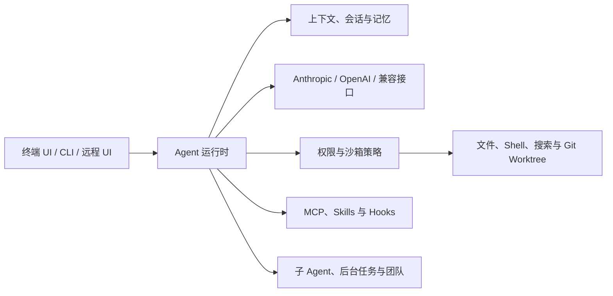

# LuxCode

**一个以终端为核心、具备明确权限边界、持久上下文和多 Agent 工作流的 AI 编程助手。**

[English](README.md) | [简体中文](README.zh-CN.md)

LuxCode 将大语言模型接入一套可实际执行编程任务的 Agent 运行时。它能够读取和修改文件、执行命令、搜索代码仓库、保留项目上下文、调用 MCP 服务，并通过终端交互界面协调多个专业 Agent。

这个项目基于一个简单理念：AI 编程助手可以拥有强大的工具，但每一个动作都应经过可见、可配置的边界控制。

## 核心能力

- **终端原生体验** — 基于 Textual 的流式交互界面，可展示对话、工具调用、计划、状态和后台任务。
- **多模型协议** — 支持 Anthropic、OpenAI 以及 OpenAI-compatible 接口。
- **Agent 工具循环** — 内置文件读取、写入、编辑、Shell 执行、文件匹配和代码搜索工具。
- **权限控制** — 支持逐次确认、自动接受编辑、计划模式和完全放行等权限策略。
- **上下文与记忆** — 支持会话持久化、自动或手动上下文压缩、项目记忆和文件检查点。
- **可扩展运行时** — 可接入 MCP Server、Skills、生命周期 Hooks 和动态发现工具。
- **多 Agent 执行** — 可委派子 Agent、运行后台任务，并组织多 Agent 团队协作。
- **Git 隔离开发** — 通过 Worktree 并行处理任务，避免不同修改混在同一工作目录。
- **三种运行方式** — 交互式 TUI、非交互式 CLI/NDJSON，以及浏览器远程界面。

## 架构概览



LuxCode 的核心是一个事件驱动循环：构建当前上下文、流式接收模型响应、校验工具调用、执行已批准的动作、将结果回填给模型，并持续运行直到任务完成。

## 环境要求

- Python 3.11 或更高版本
- 使用 [uv](https://docs.astral.sh/uv/) 管理依赖和虚拟环境
- 使用 Git 支持仓库及 Worktree 功能
- 只有通过 `npx` 启动 MCP Server 时才需要 Node.js
- 至少一个模型服务商的 API Key

## 快速开始

克隆仓库并安装依赖：

```bash
git clone https://github.com/diveintonull/luxcode.git
cd luxcode
uv sync
```

在项目目录下创建 `.luxcode/config.yaml`：

```yaml
providers:
  - name: anthropic
    protocol: anthropic
    base_url: https://api.anthropic.com
    api_key: ""
    model: your-model-name
    thinking: false

permission_mode: default
mcp_servers: []
```

将 `api_key` 留空即可从环境变量读取：

```bash
export ANTHROPIC_API_KEY="your-api-key"
# OpenAI 或 OpenAI-compatible 服务使用：
export OPENAI_API_KEY="your-api-key"
```

PowerShell 用户可以使用 `$env:ANTHROPIC_API_KEY = "your-api-key"` 或 `$env:OPENAI_API_KEY = "your-api-key"`。

启动交互界面：

```bash
uv run luxcode
```

## 配置说明

LuxCode 会按以下顺序加载并合并配置：

1. `~/.luxcode/config.yaml`
2. `<project>/.luxcode/config.yaml`
3. `<project>/.luxcode/config.local.yaml`

因此可以在用户目录保存通用 Provider 配置，再针对不同项目覆盖。本仓库已忽略本地 `.luxcode` 文件，避免 API Key 被意外提交。

### OpenAI 配置示例

```yaml
providers:
  - name: openai
    protocol: openai
    base_url: https://api.openai.com/v1
    api_key: ""
    model: your-model-name
```

如果使用其他 OpenAI-compatible 服务，请设置 `protocol: openai-compat`，并填写对应的 API Base URL。

### MCP 配置示例

LuxCode 支持本地 stdio Server，也支持 Streamable HTTP Endpoint：

```yaml
mcp_servers:
  - name: context7
    command: npx
    args: ["-y", "@upstash/context7-mcp"]

  - name: remote-tools
    url: https://example.com/mcp
    headers:
      Authorization: "Bearer ${MY_MCP_TOKEN}"
```

`${NAME}` 形式的环境变量会在运行时展开。

## 使用方式

### 交互模式

```bash
uv run luxcode
```

常用 Slash 命令：

| 命令 | 用途 |
| --- | --- |
| `/help` | 查看命令及用法 |
| `/plan` | 切换到计划模式 |
| `/permission` | 查看或修改权限规则 |
| `/sandbox` | 配置操作系统级命令隔离 |
| `/compact` | 压缩当前上下文 |
| `/memory` | 查看、编辑或清空记忆 |
| `/session` | 新建、查看、恢复或删除会话 |
| `/mcp` | 查看 MCP Server 状态 |
| `/skill` | 查看和重新加载 Skills |
| `/tasks` | 查看或取消后台任务 |
| `/trace` | 展示 Agent 父子追踪树 |
| `/worktree` | 管理隔离的 Git Worktree |
| `/rewind` | 回到之前的文件检查点 |
| `/status` | 查看当前运行状态 |

### 非交互模式

执行单次任务并输出最终结果：

```bash
uv run luxcode -p "解释这个仓库的架构"
```

为脚本或其他集成输出 NDJSON 事件流：

```bash
uv run luxcode -p "审查当前代码修改" --output-format stream-json
```

### 远程模式

```bash
uv run luxcode --remote
```

然后访问 `http://localhost:18888`。远程模式会监听 `0.0.0.0:18888`，请仅在可信网络中使用，或通过防火墙、反向代理保护该端口。

### 权限模式

可以通过 `--mode` 临时覆盖配置：

```bash
uv run luxcode --mode acceptEdits
```

| 模式 | 文件读取 | 文件写入 | 命令执行 |
| --- | --- | --- | --- |
| `default` | 允许 | 询问 | 询问 |
| `acceptEdits` | 允许 | 允许 | 询问 |
| `plan` | 允许 | 询问 | 询问 |
| `bypassPermissions` | 允许 | 允许 | 允许 |

只有在能够接受不受限制的文件修改和命令执行时，才应使用 `bypassPermissions`。

## 项目结构

```text
luxcode/
├── luxcode/
│   ├── agents/       # 子 Agent、调用追踪与任务编排
│   ├── commands/     # 交互式 Slash 命令
│   ├── context/      # 上下文窗口管理
│   ├── hooks/        # 生命周期 Hook 与条件判断
│   ├── mcp/          # MCP 客户端和工具集成
│   ├── memory/       # 会话、记忆召回与整合
│   ├── permissions/  # 权限模式与策略检查
│   ├── sandbox/      # 操作系统级命令隔离
│   ├── skills/       # Skill 发现与执行
│   ├── teams/        # 多 Agent 团队协作
│   ├── tools/        # 内置编程工具
│   └── worktree/     # Git Worktree 生命周期
├── tests/            # Pytest 测试套件
├── pyproject.toml
└── uv.lock
```

## 开发与测试

安装锁定的开发环境并运行完整测试：

```bash
uv sync
uv run pytest
```

开发过程中也可以只运行特定测试：

```bash
uv run pytest tests/test_permissions.py -q
```

## 安全提示

- 不要提交 `.luxcode/config.yaml` 或真实的 Provider 凭据。
- 批准文件写入或 Shell 命令前，请先检查工具请求内容。
- 日常开发建议使用 `default` 或 `acceptEdits` 模式。
- 操作系统级沙箱能力取决于当前平台和本地工具。
- 远程模式会监听所有网络接口，不要直接暴露到不可信网络。

## 项目状态

LuxCode 当前版本为 `0.2.0`。本项目仍在持续演进，适合用于学习、实验以及构建实际的 Agent 运行时工作流。
